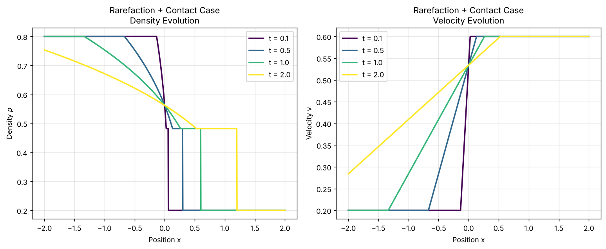
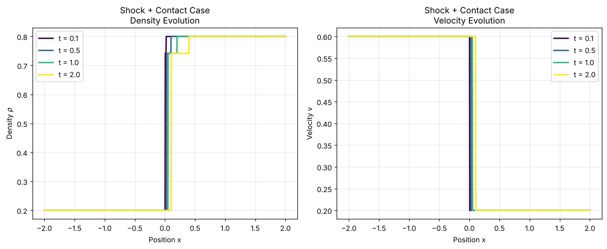

# Traffic Waves as Hyperbolic Conservation Laws

Derivation and analysis of the Lighthill–Whitham–Richards (LWR) and Aw–Rascle traffic models, including the complete solution of the Aw–Rascle Riemann problem.

**TU/e · Group project on hyperbolic conservation laws**

<!-- REPORT_LINK -->

## Problem

The LWR model treats traffic density as a single conserved quantity but assumes that drivers adjust their speed instantly. The Aw–Rascle (AR) model adds a second conservation law with a "traffic pressure" $p(\rho)$ that represents drivers anticipating conditions downstream:

$$\partial_t \rho + \partial_x(\rho v) = 0, \qquad \partial_t\big(\rho\,(v + p(\rho))\big) + \partial_x\big(\rho v\,(v + p(\rho))\big) = 0$$

## Approach

- Derived LWR from conservation of cars and solved it with the method of characteristics. For $v = 1 - \rho$, the first jam (shock) forms at $t_b = 1/\max(2\rho_0')$.
- Classified the AR system. Its eigenvalues are $\lambda_1 = v - \rho\,p'(\rho)$ and $\lambda_2 = v$, so it is strictly hyperbolic whenever $\rho > 0$. The first field is genuinely non-linear (rarefaction or shock) and the second is linearly degenerate (contact discontinuity). Derived the Riemann invariants of both families.
- Solved the Riemann problem. The left state connects to an intermediate state by a 1-rarefaction or a 1-shock, and then to the right state by a 2-contact, with $v_m = v_r$ and $\rho_m = p^{-1}\big(v_l + p(\rho_l) - v_r\big)$. Admissible shocks follow from the Lax entropy condition and occur exactly when $\rho_m > \rho_l$.

## Results

Visualising the exact solution with $p(\rho) = \rho^3$ at $t = 0.1, 0.5, 1, 2$:

- **Leaving a jam**, from $(\rho_l, v_l) = (0.8, 0.2)$ to $(\rho_r, v_r) = (0.2, 0.6)$: a smooth rarefaction fan down to $\rho_m \approx 0.48$, followed by a contact jump. The fan widens over time as cars accelerate and spread out.
- **Forming a jam**, from $(0.2, 0.6)$ to $(0.8, 0.2)$: a shock up to $\rho_m \approx 0.74$, followed by a contact discontinuity. The shock moves right at about 0.05, slower than the contact at 0.2, so the congested region between them widens over time. This is the mechanism behind "phantom" traffic jams.

  <em>Density and velocity profiles for the rarefaction case (top) and the shock case (bottom).</em>

## Repository contents

- `src/ar_simulation.py`: exact Riemann solver for the Aw–Rascle model (intermediate state, bisection inside the rarefaction fan, shock speed) and the plots above. Run with `python ar_simulation.py`.

**Tools:** Python · NumPy · Matplotlib
